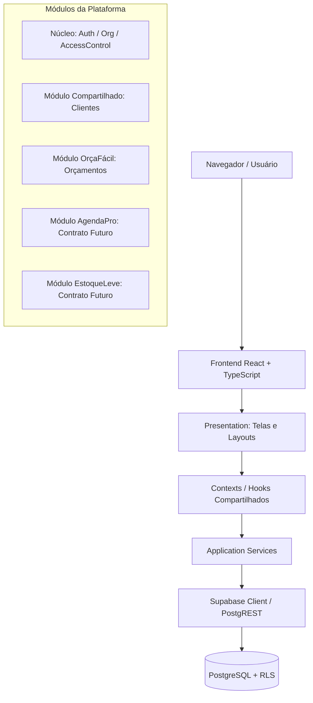

# Arquitetura da Plataforma OrçaFácil

## 1. Visão Geral

A **OrçaFácil Platform** foi arquitetada como um **Monólito Modular** centrado no frontend em React/TypeScript, utilizando o **Supabase** como infraestrutura gerenciada de backend (PostgreSQL, Supabase Auth, Row Level Security e RPCs).

---

## 2. Separação de Responsabilidades (Layers)

1. **Presentation (`pages/`, `components/`, `layouts/`):**
   - Renderização visual e interação com o usuário.
   - Formulários com validação imediata via Zod.
   - Não contém regras de negócio críticas nem consultas SQL manuais.

2. **Application (`services/`, `context/`):**
   - Orquestração de casos de uso (ex: `quoteService.createQuote`, `authService.signIn`).
   - Gerenciamento de estado global por domínio (`AuthContext`, `OrganizationContext`, `ModuleAccessContext`).
   - Recálculo de valores monetários antes do envio.

3. **Domain (`domain/`):**
   - Entidades, máquinas de estados (ex: `isValidStatusTransition`) e regras aritméticas puras (`quote-calculations.ts`).
   - Livre de acoplamento com bibliotecas de terceiros ou frameworks.

4. **Infrastructure (`app/config/supabase.ts`, `migrations/`):**
   - Conexão com o Supabase, migrações versionadas em SQL, triggers e funções PostgreSQL (`SECURITY DEFINER`).

---

## 3. Regras de Dependência e Desacoplamento

- **Núcleo Compartilhado Independente:** O núcleo (`auth`, `organizations`, `access-control`) desconhece entidades específicas do OrçaFácil (`quotes`, `quote_items`).
- **Autenticação Centralizada:** Nenhum módulo cria autenticação própria.
- **Isolamento entre Módulos:** Os módulos de negócio não acessam tabelas internas de outros módulos. Integrações futuras (ex: AgendaPro precisando de orçamentos) utilizarão contratos públicos ou serviços compartilhados.
- **Base de Clientes Compartilhada:** O cadastro de clientes (`customers`) é transversal dentro da organização e reaproveitado por todos os módulos.

