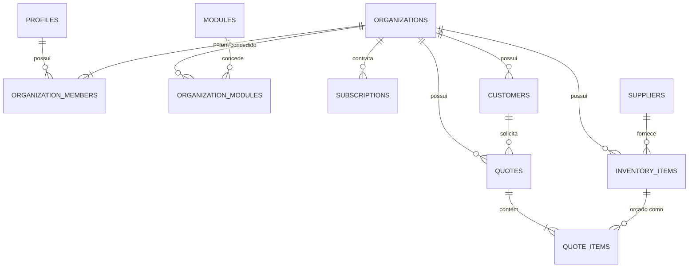

# Modelo de Dados e Banco de Dados

## 1. Visão Geral das Entidades

O banco de dados PostgreSQL é gerenciado no Supabase através de migrações SQL versionadas na pasta `supabase/migrations/`.

---

## 2. Dicionário de Tabelas

### `profiles`

Extensão pública do `auth.users`. Criado automaticamente via trigger `handle_new_user()` no signup.

- `id` (UUID, PK -> `auth.users.id`)
- `display_name` (TEXT)
- `created_at`, `updated_at` (TIMESTAMPTZ)

### `organizations`

Representa uma empresa, profissional autônomo ou workspace.

- `id` (UUID, PK)
- `name` (TEXT, >= 2 caracteres)
- `slug` (TEXT, UNIQUE, regex `^[a-z0-9-]+$`)
- `created_at`, `updated_at` (TIMESTAMPTZ)

### `organization_members`

Associação N:N entre usuários e organizações, definindo o papel.

- `organization_id` (UUID, FK -> `organizations.id` ON DELETE CASCADE)
- `user_id` (UUID, FK -> `auth.users.id` ON DELETE CASCADE)
- `role` (ENUM: `'owner'`, `'admin'`, `'member'`)
- Restrição: `PRIMARY KEY (organization_id, user_id)`

### `modules`

Catálogo estático de módulos disponíveis na plataforma.

- `id` (UUID, PK)
- `code` (ENUM: `'orcafacil'`, `'agendapro'`, `'estoqueleve'`, UNIQUE)
- `name` (TEXT)
- `is_globally_available` (BOOLEAN)

### `organization_modules`

Concessões de acesso ativo aos módulos para cada organização (Entitlements).

- `organization_id` (UUID, FK -> `organizations.id` ON DELETE CASCADE)
- `module_id` (UUID, FK -> `modules.id` ON DELETE RESTRICT)
- `status` (ENUM: `'active'`, `'inactive'`, `'suspended'`)
- `activated_at`, `expires_at` (TIMESTAMPTZ)
- Restrição: `PRIMARY KEY (organization_id, module_id)`

### `subscriptions`

Controle de plano e cobrança da organização.

- `id` (UUID, PK)
- `organization_id` (UUID, FK -> `organizations.id` ON DELETE CASCADE)
- `plan_id` (TEXT, default `'free'`)
- `status` (ENUM: `'trialing'`, `'active'`, `'past_due'`, `'canceled'`, `'unpaid'`)
- `external_customer_id`, `external_subscription_id` (TEXT)
- `current_period_start`, `current_period_end` (TIMESTAMPTZ)

### `customers`

Clientes cadastrados pela organização.

- `id` (UUID, PK)
- `organization_id` (UUID, FK -> `organizations.id` ON DELETE CASCADE)
- `name` (TEXT, >= 2 caracteres)
- `phone`, `email`, `address` (TEXT)
- Chave composta única: `UNIQUE (organization_id, id)`

### `inventory_items`

Produtos da organização, com unidade de estoque configurável, identificação, preços e dados de reposição.

- `id` (UUID, PK)
- `organization_id` (UUID)
- `supplier_id` (UUID, fornecedor principal opcional)
- `name` (TEXT)
- `unit` (TEXT, por exemplo: metro, kg ou litro)
- `quantity_on_hand`, `minimum_quantity`, `unit_price` (NUMERIC(12, 4))
- `sku` e `barcode` (identificadores únicos por organização)
- Categoria, marca/modelo, custo/preços, local de armazenagem, campos fiscais e atributos em JSONB.
- `is_active`, `can_sell` e `can_purchase` controlam a disponibilidade do produto.
- Produtos com histórico são desativados em vez de excluídos.
- Chaves compostas garantem que fornecedor e orçamento pertençam à mesma organização.
- O saldo é reduzido ao aprovar o orçamento; exclusão de orçamento aprovado restaura o saldo.
- Alterações de saldo exigem uma movimentação registrada.

### `inventory_item_suppliers`

Relaciona produtos a vários fornecedores da mesma organização, com código e custo de compra específicos do vínculo.

### `inventory_movements`

Histórico imutável de entradas, saídas, ajustes, saldo inicial e alterações originadas por orçamentos. Guarda quantidade, saldo anterior/posterior, motivo, documento e usuário; a RPC `record_inventory_movement` atualiza o saldo de forma transacional.

### `quotes`

Orçamentos comerciais gerados no módulo JB Software.

- `id` (UUID, PK)
- `organization_id` (UUID, FK -> `organizations.id` ON DELETE CASCADE)
- `customer_id` (UUID)
- `quote_number` (TEXT)
- `status` (ENUM: `'draft'`, `'sent'`, `'approved'`, `'rejected'`, `'expired'`)
- `subtotal` (NUMERIC(12, 2))
- `discount` (NUMERIC(12, 2))
- `total` (NUMERIC(12, 2))
- `valid_until` (DATE)
- `notes` (TEXT)
- Integridade multi-tenant:
  `FOREIGN KEY (organization_id, customer_id) REFERENCES customers(organization_id, id) ON DELETE RESTRICT`
  `UNIQUE (organization_id, id)`

### `quote_items`

Itens e serviços que compõem o orçamento.

- `id` (UUID, PK)
- `organization_id` (UUID)
- `quote_id` (UUID)
- `description` (TEXT)
- `quantity` (NUMERIC(12, 4), > 0)
- `unit_price` (NUMERIC(12, 4), >= 0)
- `inventory_item_id` (UUID, opcional; material vinculado ao estoque)
- `unit` (TEXT, cópia da unidade no momento do orçamento)
- `total` (NUMERIC(12, 2))
- `sort_order` (INTEGER)
- O valor unitário de um material vinculado não pode ficar abaixo de `inventory_items.minimum_sale_price`; a regra é validada na aplicação e protegida por triggers no banco, inclusive ao enviar ou aprovar o orçamento.
- Integridade multi-tenant:
  `FOREIGN KEY (organization_id, quote_id) REFERENCES quotes(organization_id, id) ON DELETE CASCADE`

---

## 3. Integridade Multi-Tenant por Chaves Compostas

Para evitar que ataques de substituição de IDs (IDOR) associem um cliente da Organização A a um orçamento da Organização B:

1. `customers` define `CONSTRAINT uq_customers_org_id UNIQUE (organization_id, id)`.
2. `quotes` referencia `(organization_id, customer_id) REFERENCES customers(organization_id, id)`.
   Dessa forma, o PostgreSQL **recusa** no nível do banco qualquer tentativa de cruzamento entre organizações distintas.
